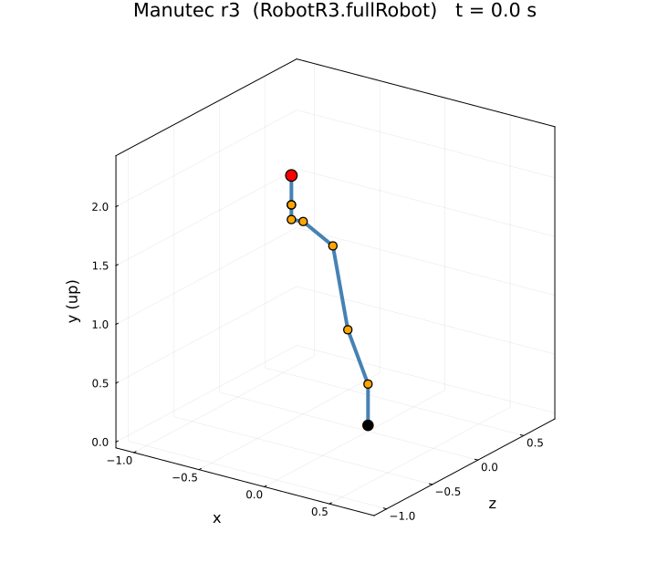
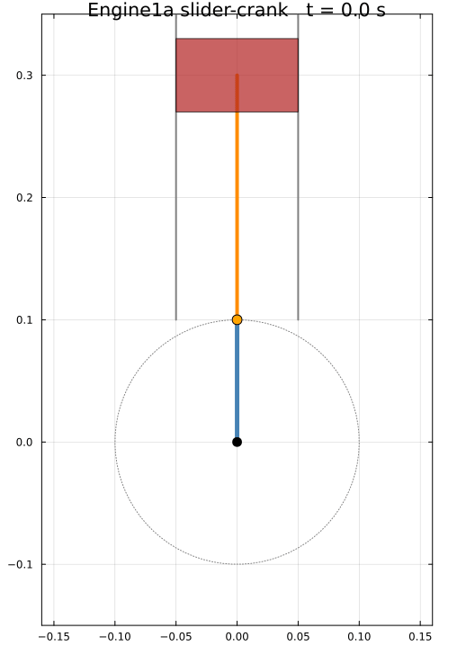

# OpenModelicaJL (OM.jl) [](https://jkrt.github.io/OM.jl/dev/) [](OSMC-License.txt)
A Modelica Environment in Julia.

Documentation: <https://jkrt.github.io/OM.jl/dev/> (installation, examples, [Modelica libraries](https://jkrt.github.io/OM.jl/dev/libraries/), large array models, [scripting in Julia](https://jkrt.github.io/OM.jl/dev/julia/) and with `.mos`, [coverage](https://jkrt.github.io/OM.jl/dev/coverage/), [troubleshooting](https://jkrt.github.io/OM.jl/dev/troubleshooting/), API).

In the REPL, `OM.help()` lists the main functions by task and `OM.help(:examples)` shows worked examples:
models of the MSL, of libraries of your own and of installed ones (their files are in
[`examples/Libraries`](examples/Libraries)).

Please leave a star or make an issue to support the repository!
* Note that this package is still under development

## Showcase: animating MultiBody models

The Manutec r3 robot (`Modelica.Mechanics.MultiBody.Examples.Systems.RobotR3.fullRobot`)
simulated end-to-end with OM.jl and animated from the resulting joint angles:



This is a full electro-mechanical model: six motor drives with gear friction and
PI controllers, a path planner, and the multibody mechanics. See
[`examples/Animation/Robot`](examples/Animation/Robot) for the runnable example and
the forward-kinematics walkthrough.

The one-cylinder engine (`Modelica.Mechanics.MultiBody.Examples.Loops.Engine1a`),
a planar slider-crank loop solved by OM.jl and animated from the crankshaft angle:



See [`examples/Animation/Engine`](examples/Animation/Engine) for the runnable
example and the slider-crank walkthrough.

## Modelica libraries

OM.jl ships the Modelica Standard Library 3.2.3 and 4.1.0, and loads any other Modelica library: installed with
OpenModelica, installed by OM.jl from its git repository (GitHub, say), or a folder of your own. The libraries a
library uses come along, and a missing one is reported by name before anything is parsed.

**→ [Libraries guide, with examples](https://jkrt.github.io/OM.jl/dev/libraries/)**

```julia
import OM

# The bundled MSL, by version
OM.simulate("Modelica.Blocks.Examples.PID_Controller"; MSL_Version = "MSL:4.1.0", stopTime = 4.0)

# A library from GitHub, installed once into ~/OMJL/libraries (Windows: %APPDATA%\OMJL\libraries)
OM.installLibrary("ExternData"; version = "3.2.0", url = "https://github.com/modelica-3rdparty/ExternData")
key = OM.loadInstalledLibrary("ExternData")

# A model of an installed library (Buildings is registered: no url needed). A loaded library stays
# loaded, as in omc: later calls see it without `libraries` (OM.loadedLibraries(), OM.unloadLibrary)
OM.installLibrary("Buildings"; version = "13.0.0")
key = OM.loadInstalledLibrary("Buildings")
sol = OM.simulate("Buildings.Controls.OBC.CDL.Reals.Validation.Add")

# Your own model on an installed library (Smoothing.mo uses Modelica.Blocks; the guide shows it)
msl = OM.loadInstalledLibrary("Modelica"; version = "4.1.0")
sol = OM.simulate("Smoothing", "Smoothing.mo")

# What is installed: OM.jl's directory and OpenModelica's
OM.libraries()
```

## Developer instructions
---

Fetch all submodules:

```
git submodule update --init --recursive
```

Make sure that all submodules are on master

```
git submodule foreach "git checkout master && git pull"
```

## Install manually be developing the subpackages

  - Go to ImmutableList.jl
  - Dev it using the Julia package manager
  - Go to MetaModelica.jl
  - Dev it using the Julia package manager
  - Go to Absyn.jl

Using same procedure as above for:
  - ArrayUtil.jl
  - ListUtil.jl
Once this is done develop SCode and last but not least the DAE.

## Core modules
    - Develop the OpenModelicaParser.jl
    - Develop OMFrontend.jl
    - Develop OMBackend.jl
    - Develop the OM package

(Since this is currently work in progress expect some warnings)

## Adding the OpenModelicRegistry
To work with the package manager and manage dependencies of these packages
you also need to add the OpenModelicaRegistry.
To do this issue:
```
registry add https://github.com/OpenModelica/OpenModelicaRegistry.git
```
This will add this additional registry.

On Julia 1.13.0 and 1.13.1 the package manager cannot update a registry it added
by URL, so new versions are not seen. Remove and add it again to update it:
`registry rm OpenModelica`, then the `registry add` above.

## TL;DR
```julia
julia> include("install.jl")
```

## Example usage
Navigate to the test directory.
```
cd test
```

```julia
using Plots
import OM
OM.translate("HelloWorld", "./Models/HelloWorld.mo");
res = OM.simulate("HelloWorld");
# Optional debugging aid:
# OM.translate("HelloWorld", "./Models/HelloWorld.mo"; warnMissingStartValues = true)
# OM.simulate("HelloWorld"; warnMissingStartValues = true)
plot(res)
#= Resimulate the same model, from 0.0 to 2.0 =#
sol = OM.resimulate("HelloWorld"; startTime = 0.0, stopTime = 2.0)
plot(sol)
```

Simulating & Plotting a simple mechanical system.
```modelica
model SimpleMechanicalSystem
  parameter Real J1 = 1 , J2 = 1;
  constant Real C = 1;
  Real u;
  Real Phi_1, Phi_2;
  Real omega_1 , omega_2;
  Real tau_1, tau_2, tau_3;
initial equation
  omega_1 = 0;
  omega_2 = 0;
  Phi_1 = 0;
  Phi_2 = 0;
equation
  u = time;
  // The Algebraic variables
  tau_1 = u;
  tau_2 = C * (Phi_2 - Phi_1);
  tau_3 = -tau_2;
  der(Phi_1) = omega_1 ;
  der(Phi_2) = omega_2;
  der(omega_1) = (tau_1 + tau_2) / J1;
  der(omega_2) = tau_3 / J2;
end SimpleMechanicalSystem;
```
Execute the following commands:
```julia
using Plots
import OM
OM.translate("SimpleMechanicalSystem", "./Models/SimpleMechanicalSystem.mo");
sol = OM.simulate("SimpleMechanicalSystem");
plot(sol)
#= Resimulate the system from 0.0 to 3.0 =#
sol = OM.resimulate("SimpleMechanicalSystem"; startTime = 0.0, stopTime = 3.0)
plot(sol)
```

### Exporting Flat Modelica
Navigate to the test folder.

In the test folder we have the following Influenza model:

```modelica
model Influenza
  input Real Introduction = 77;
  Population Immune_Popul(p(start = 10));
  Population Non_Infected_Popul(p(start = 100));
  Population Infected_Popul(p(start = 50));
  Population Sick_Popul(p(start = 0));
  Division Incubation;
  Division Cure_Rate;
  Division Activation;
  Division Perc_Infected;
  Constants Time_to_Breakdown;
  Constants Sickness_Duration;
  Constants Contraction_Rate;
  Constants Immune_Period;
  Sum Contagious_Popul;
  Sum Non_Contagious_Popul;
  Sum Total_Popul;
  Sum Temp3;
  Product1 Contacts_Wk;
  Product2 Temp1;
  Product2 Temp2;
  Minimum Infection_Rate;
equation
  connect(Incubation.in_1,Infected_Popul.out_1);
  connect(Incubation.in_2,Time_to_Breakdown.out_1);
  connect(Infected_Popul.in_2,Incubation.out_1);
  connect(Sick_Popul.in_1,Incubation.out_1);
  connect(Cure_Rate.in_1,Sick_Popul.out_1);
  connect(Cure_Rate.in_2,Sickness_Duration.out_1);
  connect(Immune_Popul.in_1,Cure_Rate.out_1);
  connect(Sick_Popul.in_2,Cure_Rate.out_1);
  connect(Activation.in_1,Immune_Popul.out_1);
  connect(Activation.in_2,Immune_Period.out_1);
  connect(Immune_Popul.in_1,Activation.out_1);
  connect(Non_Infected_Popul.in_1,Activation.out_1);
  connect(Temp2.in_1,Contraction_Rate.out_1);
  connect(Contagious_Popul.in_1,Infected_Popul.out_1);
  connect(Contagious_Popul.in_2,Sick_Popul.out_1);
  connect(Perc_Infected.in_1,Contagious_Popul.out_1);
  connect(Total_Popul.in_1,Contagious_Popul.out_1);
  connect(Non_Contagious_Popul.in_1,Non_Infected_Popul.out_1);
  connect(Non_Contagious_Popul.in_2,Immune_Popul.out_1);
  connect(Total_Popul.in_2,Non_Contagious_Popul.out_1);
  connect(Perc_Infected.in_2,Total_Popul.out_1);
  connect(Temp1.in_1,Perc_Infected.out_1);
  connect(Contacts_Wk.in_1,Non_Infected_Popul.out_1);
  connect(Temp1.in_2,Contacts_Wk.out_1);
  connect(Temp2.in_2,Temp1.out_1);
  connect(Temp3.in_1,Temp2.out_1);
  Temp3.in_2 = Introduction;
  connect(Infection_Rate.in_1,Temp3.out_1);
  connect(Infection_Rate.in_2,Non_Infected_Popul.out_1);
  connect(Infected_Popul.in_1,Infection_Rate.out_1);
  connect(Non_Infected_Popul.in_2,Infection_Rate.out_1);
end Influenza;
```

To export this model to flat Modelica. Execute the following command:

```julia
flatModelica = OM.exportModelica("Influenza", "./Models/Influenza.mo")
print(modelName)
```
### Using different versions of the Modelica Standard Library
MSL 4.1.0 (the default) and 3.2.3 are bundled; `MSL_Version` picks one for a model in a file:

```julia
jl = OM.translate("<model_using_msl_4>", "<filepath>"; MSL = true, MSL_Version = "MSL:4.1.0")
jl = OM.translate("<model_using_msl_3>", "<filepath>"; MSL = true, MSL_Version = "MSL:3.2.3")
```

Any other version, and any other library, is an installed one: see [Modelica libraries](#modelica-libraries) and
the [Libraries guide](https://jkrt.github.io/OM.jl/dev/libraries/).

### Additional notes
There are some code examples in the test folder at the root of the repository `OM/test/runtests.jl`
To run the test and get more ideas on how to use this package you can run the test and see how the code is defined there.

```julia
include("runtests.jl")
```

## How do I export my simulation result to OpenModelica?
To export your simulation result you can use the exportCSV function.
For more information about the function type `julia>? OM.exportCSV` in your terminal.

Example:
```julia
julia> OM.translate("HelloWorld", "./Models/HelloWorld.mo");
julia> sol = OM.simulate("HelloWorld");
julia> OM.exportCSV("HelloWorld", sol)
"HelloWorld_res.csv"
```
You can then open `HelloWorld_res.csv` using OMEdit and view the simulation results.

Furthermore, you can of course you can use the Plots.jl package to plot as well.

```julia
julia> begin
import OM
import CSV
import DataFrames
using Plots
sol = OM.simulate("HelloWorld", "./Models/HelloWorld.mo")
OM.exportCSV("modelName", sol; filePath = "filename.csv")
f = CSV.read("./filename.csv", DataFrame)
DataFrames.DataFrame(f)
plot(f.time, f.x)
end
```

## Other useful commands
```julia
#Lists compiled models
OM.OMBackend.availableModels()
#Prints a compiled model
OM.OMBackend.printModel(<model name>)
#Write a model to file with redundant begin blocks and comments removed.
OM.OMBackend.writeModelToFile("model", "model.jl"; keepComments = true, keepBeginBlocks=false)
# Plotting a specific variable from an obtained solution if you are using Plots.jl
using Plots
plot(sol[:t], sol[:x])
```

## Troubleshooting

### Debug logging

Backend and VSS (Variable Structure Systems) debug logging can be enabled via environment variables.
These are checked at module load time, so they must be set before starting Julia:

```bash
# Enable backend logging
ENABLE_BACKEND_LOGGING=true julia

# Enable VSS runtime debug logging
ENABLE_VSS_DEBUG=true julia

# Enable both
ENABLE_BACKEND_LOGGING=true ENABLE_VSS_DEBUG=true julia
```

## Submodules

OM.jl is composed of several submodules, each in its own directory:

| Submodule | Description |
|-----------|-------------|
| **Absyn.jl** | Abstract syntax tree representation for Modelica (output of the parser) |
| **SCode.jl** | Simplified code representation (intermediate form between Absyn and the frontend) |
| **OMParser.jl** | Modelica parser that produces Absyn |
| **OMFrontend.jl** | The new frontend (NF) that performs instantiation, typing, flattening, and simplification |
| **OMBackend.jl** | Backend that lowers the flat model to its own IR (OMJLIR), runs its passes, matches and sorts it into the simulation code, and generates and simulates the system via ModelingToolkit.jl |
| **DAE.jl** | Data structures of the frontend's DAE form (`OMFrontend.instantiateSCodeToDAE`); the backend does not use it |
| **MetaModelica.jl** | Julia implementation of MetaModelica language constructs (uniontypes, pattern matching, immutable lists) |
| **ImmutableList.jl** | Immutable cons-list implementation used throughout the compiler |
| **ArrayUtil.jl** | Array utility functions (fold, map, etc.) |
| **ListUtil.jl** | Utility functions for immutable list operations |
| **OMRuntimeExternalC.jl** | Runtime bindings to external C libraries (ModelicaIO, ModelicaStandardTables, ModelicaExternalC) used by compiled models |
| **OMLibraryTesting.jl** | Test harness for running MSL coverage and regression tests |

All submodules are fetched via `git submodule update --init --recursive`.

## Collaboration & Contact
Please email me at the email located here [LiU-page](https://liu.se/en/employee/johti17)
